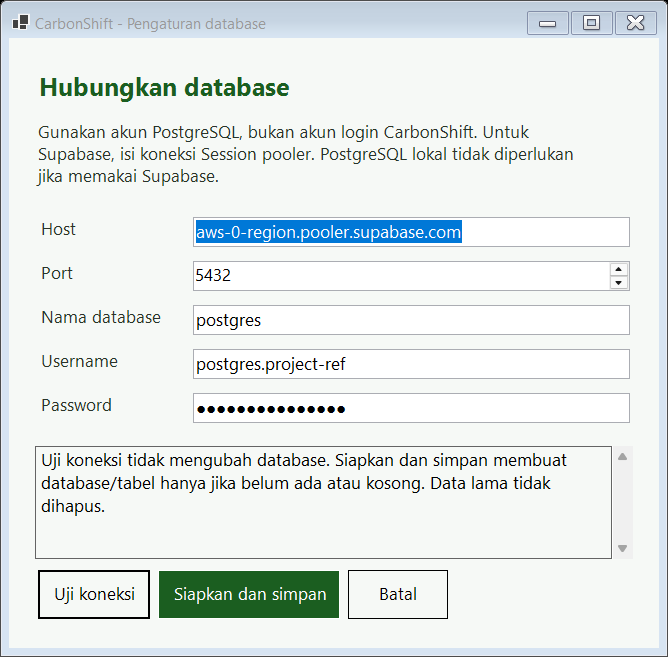
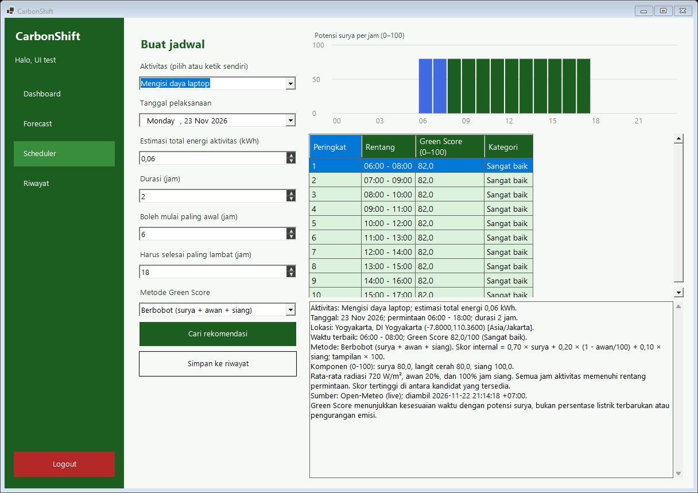

# Panduan Pengguna CarbonShift

**Junior Project - Climate Action | Versi 1.0.0 | Windows x64**

CarbonShift membantu memilih waktu aktivitas listrik berdasarkan prakiraan cuaca dan potensi surya. Pengguna dapat membuat akun, mencari rekomendasi, menyimpan jadwal, dan melihat riwayatnya sendiri.

## 1. Sebelum menjalankan aplikasi

- Gunakan Windows 64-bit. Paket ini tidak ditujukan untuk macOS, Linux, atau Windows 32-bit.
- Visual Studio, .NET SDK, dan .NET Runtime tidak perlu dipasang untuk memakai paket self-contained.
- Database memakai PostgreSQL di Supabase. Kamu tidak perlu memasang PostgreSQL lokal.
- Internet diperlukan untuk login, register, riwayat, pencarian kota, dan forecast terbaru. Cache forecast tidak menggantikan koneksi database.

### Siapkan koneksi dari pengelola

1. Minta host, port, nama database, username Session pooler, dan password database kepada pengelola secara privat.
2. Pastikan pengelola sudah menyiapkan database CarbonShift di Supabase. Pengguna tidak perlu membuat tabel atau menjalankan SQL.
3. Simpan password database untuk pengaturan koneksi. Saat masuk aplikasi nanti, gunakan akun CarbonShift sendiri.
4. Paket publik tidak menyertakan password database. Akses ini ditujukan untuk demonstrasi kelompok dengan peserta terbatas.

### Membuka paket

1. Klik kanan ZIP submisi, lalu pilih **Extract All** ke folder yang dapat ditulis, misalnya Documents.
2. Buka folder hasil ekstraksi, masuk ke folder **Aplikasi**, lalu jalankan **CarbonShift.exe**.
3. Pertahankan seluruh isi folder **Aplikasi**, termasuk DLL, runtime, dan sertifikat **prod-ca-2021.crt**. Jangan memindahkan hanya EXE.
4. Pada pemakaian pertama, ikuti Pengaturan database. Setelah konfigurasi berhasil, penggunaan berikutnya langsung menuju halaman Masuk.

Pengaturan dan cache disimpan dalam profil Windows di `%LocalAppData%\CarbonShift`, bukan di dalam ZIP. Laporan testing Modul 10 milik kelompok disertakan terpisah oleh pengumpul.

<!-- pagebreak -->

## 2. Pengaturan database pertama kali

Isi koneksi **Session pooler Supabase** dari pengelola, lalu pilih **Uji koneksi**. Tombol ini tidak mengubah database.

| Field | Contoh / keterangan |
| --- | --- |
| Host | Host Session pooler dari pengelola, berakhiran `.pooler.supabase.com` |
| Port | Biasanya `5432`. Ikuti informasi dari pengelola |
| Nama database | `postgres` untuk Supabase |
| Username | Username pooler dari pengelola, biasanya `postgres.<project-ref>` |
| Password | Password database dari pengelola, bukan password akun CarbonShift |

Klik **Siapkan dan simpan** setelah koneksi dan schema sesuai. Wizard menyimpan koneksi pada profil Windows. Supabase harus sudah berisi tabel CarbonShift, wizard tidak membuatnya.

Koneksi Supabase memakai TLS dengan verifikasi sertifikat CA dan nama server.

Ubah koneksi melalui **Pengaturan database** di halaman Masuk. Batal saat pengaturan ulang mempertahankan koneksi sebelumnya.

<!-- pagebreak -->

## 3. Membuat akun atau masuk

Pilih **Belum punya akun? Daftar**, isi nama dan email, lalu masukkan password 8-128 karakter dan konfirmasinya. Klik **Buat akun** untuk langsung masuk Dashboard tanpa verifikasi email.

Email tidak membedakan kapital. Password harus sama persis, termasuk spasi yang sengaja dimasukkan. Riwayat akun baru masih kosong.

Untuk masuk kembali, gunakan email dan password CarbonShift yang dibuat saat daftar. Akun lama dari DB lokal tetap dapat dipakai setelah pengelola memigrasikannya. Kredensial PostgreSQL tidak dipakai pada form Masuk ini.

Setelah Logout, aplikasi kembali ke mode Masuk dengan password kosong. Riwayat pada aplikasi mengikuti akun aktif. Akun dan riwayat dapat dibuka di komputer lain yang terhubung ke database Supabase yang sama. Lokasi terakhir dan cache tetap disimpan pada perangkat.

<!-- pagebreak -->

## 4. Pilih lokasi dan ambil forecast

1. Di Dashboard, ketik nama kota Indonesia pada field **Lokasi prakiraan**.
2. Klik **Cari kota** atau tekan Enter. Pilih kota/provinsi yang sesuai pada dropdown di field yang sama.
3. Lokasi langsung diterapkan dan forecast diambil. Periksa sumber data dan waktu pengambilannya.
4. Buka **Forecast** untuk melihat data per jam dan memilih tanggal hari ini, besok, atau lusa.

**Open-Meteo (live)** berarti data baru dari API. **Cache** adalah data tersimpan. **Cache cadangan** dipakai ketika API gagal dan umur/cakupannya masih sesuai. **DEMO** adalah data buatan yang tidak bisa disimpan sebagai jadwal.

Pengaturan lokasi hanya tampil di Dashboard. Lokasi terakhir diingat per akun. Klik **Ambil ulang forecast** untuk memperbarui data atau keluar dari mode demo. Semua jam aktivitas mengikuti zona waktu kota yang berupa WIB, WITA, atau WIT.

<!-- pagebreak -->

## 5. Cari rekomendasi dan simpan jadwal

1. Buka **Scheduler**. Pilih preset atau ketik nama aktivitas sendiri.
2. Pilih tanggal, estimasi total energi aktivitas (kWh), dan durasi 1-12 jam.
3. Atur batas mulai dan selesai dalam satu hari. Jam selesai 24 berarti tengah malam berikutnya.
4. Pilih metode skor, lalu klik **Cari rekomendasi**. Metode default memakai bobot surya 70%, awan 20%, dan siang 10%.
5. Baca waktu terbaik, peringkat alternatif, dan penjelasan. Klik **Simpan ke riwayat** untuk menyimpan rekomendasi terbaik dari data nyata/cache.

Green Score 0-100 menunjukkan kesesuaian waktu dengan potensi surya, bukan persentase listrik terbarukan atau pengurangan emisi aktual. Skor minimal 70 masuk kategori Sangat baik. Skor 40 hingga kurang dari 70 masuk kategori Cukup, dan skor di bawah 40 masuk kategori Rendah.

Perubahan input atau forecast membatalkan hasil lama. Hitung ulang sebelum menyimpan. Waktu yang sudah lewat, forecast kedaluwarsa, dan data demo tidak dapat disimpan. Jika tidak ada kandidat, coba tanggal/rentang lain atau kurangi durasi.

<!-- pagebreak -->

## 6. Riwayat, export, dan dashboard

Buka **Riwayat** setelah menyimpan. Pilih baris untuk membaca penjelasan. Data tetap tersimpan setelah aplikasi ditutup dan dibuka kembali. Tombol **Export CSV** mengekspor baris yang ditampilkan. **Hapus semua** meminta konfirmasi dan hanya menghapus riwayat akun aktif.

Dashboard merangkum jumlah jadwal pada minggu berjalan (Senin-Minggu), rata-rata skor, dan jadwal mendatang. Angka tersebut menunjukkan jadwal yang disimpan, bukan bukti aktivitas sudah dilaksanakan atau energi benar-benar dikonsumsi.

Gunakan **Logout** di bawah sidebar untuk berganti akun. Untuk mengubah koneksi PostgreSQL, lakukan dari halaman Masuk setelah logout.

<!-- pagebreak -->

## 7. Jika ada kendala

| Gejala | Langkah yang dilakukan |
| --- | --- |
| Database tidak terhubung | Periksa internet, status project Supabase, host, port, dan username Session pooler. Gunakan Uji koneksi. |
| Password database ditolak | Isi password database dari pengelola, bukan password akun CarbonShift. |
| Sertifikat ditolak | Pastikan prod-ca-2021.crt tetap ada di folder Aplikasi dan tanggal komputer benar. Minta pengelola memeriksa sertifikat. |
| Hak akses atau schema tidak sesuai | Hubungi pengelola. Jangan menjalankan SQL lokal atau menghapus tabel Supabase. |
| Email sudah terdaftar | Pilih mode Masuk atau gunakan email lain. |
| Tidak ada slot cocok | Pilih besok/lusa, perluas rentang, atau kurangi durasi. Semua interval harus memiliki data lengkap. |
| Forecast gagal | Periksa internet dan ambil ulang. Cache cadangan hanya tersedia jika pernah mengambil data yang masih sesuai. |
| Simpan nonaktif | Cari ulang setelah mengubah input. Pastikan sumber bukan DEMO dan waktunya belum lewat. |
| Konfigurasi lokal tidak tersimpan | Pastikan profil Windows dapat ditulis dan ruang penyimpanan tersedia. |

### Konfigurasi lanjutan dan pembaruan paket

Aplikasi membaca konfigurasi dari environment variable `CARBONSHIFT_DB`, konfigurasi wizard dalam `%LocalAppData%\CarbonShift\database.config`, lalu file lama di samping EXE. Jika CARBONSHIFT_DB aktif, wizard menampilkan field terkunci. Ubah/hapus variabel melalui Windows Environment Variables dan mulai ulang aplikasi untuk kembali ke konfigurasi wizard.

File konfigurasi lokal memuat kredensial PostgreSQL. Jangan memasukkannya ke ZIP atau membagikannya. Saat menerima versi aplikasi baru, ekstrak ke folder baru. Konfigurasi profil Windows dan database tetap terpisah dari paket aplikasi.

### Informasi untuk pengelola

Detail penyiapan dan migrasi ada di **Dokumentasi/Supabase.md**. Contoh koneksi tanpa password asli ada di **Database/supabase.config.example**. SQL di **Database/Lokal-opsional** hanya untuk PostgreSQL lokal, bukan Supabase.

Jangan membagikan password database atau konfigurasi pribadi bersama paket publik. Koneksi SQL langsung belum membatasi akses antar pengguna pada tingkat database. Untuk distribusi publik, siapkan backend API atau Supabase Auth beserta kebijakan RLS per pengguna.
