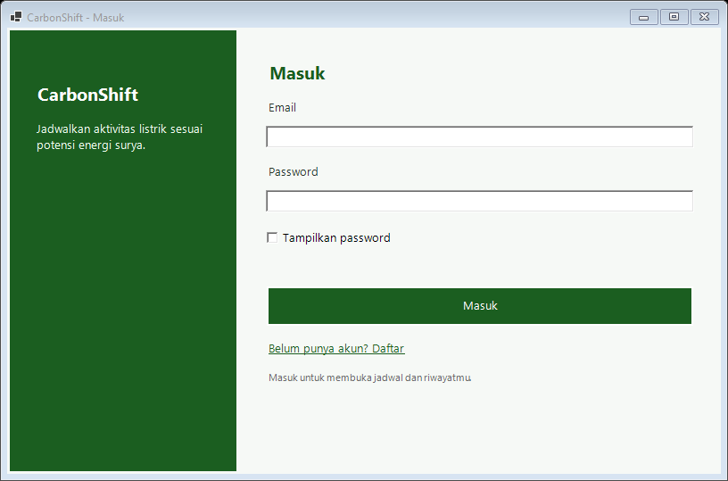
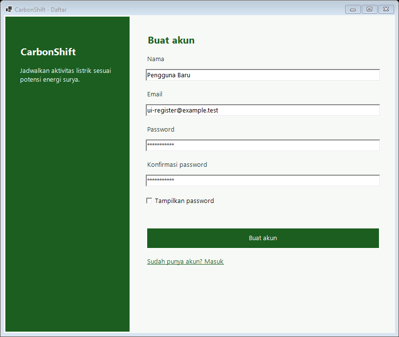
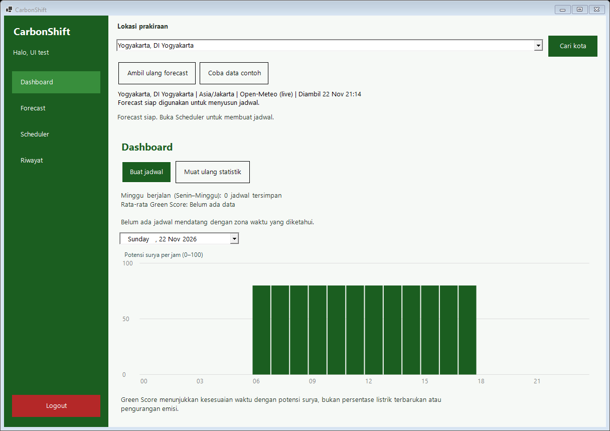
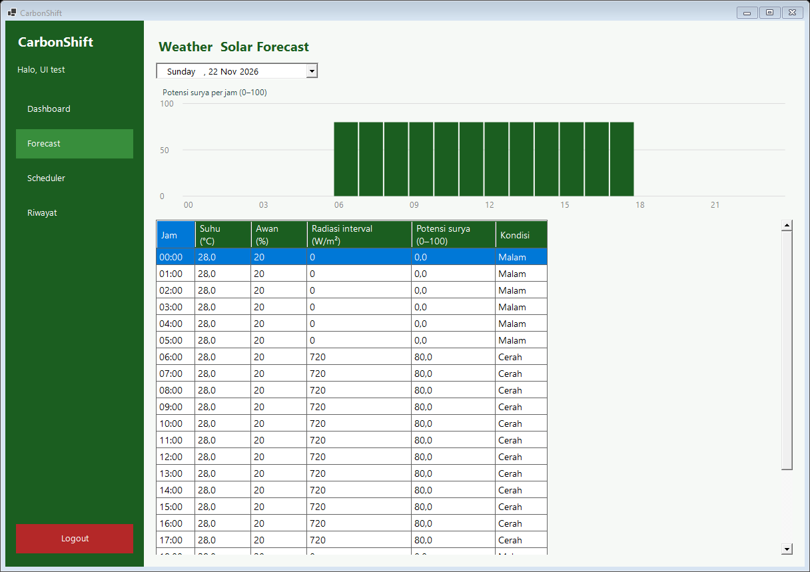

# Panduan Pengguna CarbonShift

**Junior Project - Climate Action | Versi 1.0.0 | Windows x64**

CarbonShift membantu memilih waktu aktivitas listrik berdasarkan prakiraan cuaca dan potensi surya. Kamu bisa membuat jadwal, membaca alasan rekomendasinya, lalu menyimpan dan membuka kembali riwayatnya.

## 1. Membuka aplikasi

1. Ekstrak seluruh ZIP CarbonShift ke folder pilihanmu.
2. Buka folder **Aplikasi**, lalu jalankan **CarbonShift.exe**.
3. Pastikan komputer terhubung ke internet.
4. Masukkan email dan password, lalu klik **Masuk**.

Jika belum punya akun, pilih **Belum punya akun? Daftar**. Riwayat yang sudah tersimpan tetap mengikuti akunmu.

Pertahankan isi folder Aplikasi saat memindahkannya. Saat mendapat paket baru, ekstrak ke folder baru lalu jalankan aplikasinya.

<!-- pagebreak -->

## 2. Membuat akun

1. Pilih **Belum punya akun? Daftar** pada halaman Masuk.
2. Isi nama dan email.
3. Buat password sepanjang 8-128 karakter, lalu ulangi pada kolom konfirmasi.
4. Klik **Buat akun**. Setelah berhasil, kamu langsung masuk ke Dashboard.

Gunakan email dan password tersebut saat masuk kembali. Huruf besar dan kecil pada email tidak dibedakan. Password harus sama persis, termasuk spasi yang sengaja dimasukkan.

Jika email sudah terdaftar, gunakan halaman Masuk. Untuk mengganti akun, pilih **Logout** di bagian bawah sidebar.

<!-- pagebreak -->

## 3. Memilih lokasi

1. Di Dashboard, ketik nama kota pada kolom **Lokasi prakiraan**.
2. Klik **Cari kota** atau tekan Enter.
3. Pilih kota dan provinsi yang sesuai pada daftar hasil.
4. Tunggu sampai prakiraan cuaca tampil. Klik **Ambil ulang forecast** untuk memperbaruinya.

Lokasi terakhir diingat pada perangkat yang kamu gunakan. Saat memakai komputer lain, pilih lokasinya kembali.

Grafik menunjukkan potensi surya per jam pada tanggal terpilih. Pilih **Buat jadwal** untuk menuju Scheduler.

<!-- pagebreak -->

## 4. Membaca prakiraan cuaca

Buka **Forecast** melalui sidebar. Pilih hari ini, besok, atau lusa untuk melihat suhu, awan, radiasi, dan potensi surya per jam.

Jam aktivitas mengikuti zona waktu kota yang dipilih. Periksa lokasi, tanggal, dan waktu pengambilan data sebelum membuat jadwal.

Keterangan **live** menunjukkan data yang baru diambil. **Cache** menunjukkan data tersimpan. **Cache cadangan** digunakan saat data terbaru belum dapat diambil dan data sebelumnya masih sesuai.

Tombol **Coba data contoh** membantumu mencoba tampilan. Jadwal dari mode demo tidak dapat disimpan. Klik **Ambil ulang forecast** untuk kembali memakai prakiraan cuaca.

<!-- pagebreak -->

## 5. Membuat dan menyimpan jadwal

1. Buka **Scheduler**. Pilih aktivitas yang tersedia atau ketik nama sendiri.
2. Pilih tanggal pelaksanaan, estimasi total energi dalam kWh, dan durasi 1-12 jam.
3. Tentukan jam mulai paling awal dan selesai paling lambat. Angka 24 berarti tengah malam berikutnya.
4. Pilih metode Green Score, lalu klik **Cari rekomendasi**.
5. Baca waktu terbaik, alternatif, dan penjelasannya. Klik **Simpan ke riwayat** untuk menyimpan rekomendasi terbaik.

Green Score 0-100 menunjukkan kesesuaian waktu dengan potensi surya. Skor ini bukan persentase listrik terbarukan atau pengurangan emisi. Estimasi kWh menunjukkan kebutuhan energi aktivitas.

Setelah mengubah input, cari rekomendasi lagi. Jika hasil sudah kedaluwarsa atau waktunya lewat, hitung ulang sebelum menyimpan. Riwayat menampilkan hasil yang sama dengan penjelasan rekomendasi dari layanan.

<!-- pagebreak -->

## 6. Riwayat dan dashboard

Buka **Riwayat** untuk melihat jadwal tersimpan. Pilih baris untuk membaca penjelasannya. Data tetap tersedia setelah aplikasi ditutup dan dapat dibuka dari akun yang sama di komputer lain.

**Export CSV** menyimpan baris yang sedang ditampilkan ke file pilihanmu. **Hapus semua** meminta konfirmasi sebelum menghapus riwayat akun aktif.

Dashboard merangkum jumlah jadwal minggu berjalan, rata-rata Green Score, dan jadwal berikutnya. Angka ini merangkum jadwal tersimpan, bukan aktivitas yang sudah dilaksanakan.

Gunakan **Logout** untuk keluar. Setelah aplikasi ditutup atau sesi berakhir, masuk kembali dengan akunmu.

<!-- pagebreak -->

## 7. Jika ada kendala

| Kendala | Langkah yang dapat dicoba |
| --- | --- |
| Aplikasi belum dapat terhubung | Periksa internet, tunggu sebentar, lalu coba lagi. Hubungi pengelola jika masih terjadi. |
| Email atau password salah | Periksa email dan ketik ulang password. Perhatikan huruf besar, kecil, dan spasi pada password. |
| Email sudah terdaftar | Gunakan halaman Masuk dengan akun yang sudah ada. |
| Sesi berakhir | Masuk kembali. Jadwal yang sudah tersimpan tetap ada. |
| Terlalu banyak percobaan | Tunggu beberapa menit sebelum mencoba lagi. |
| Kota tidak ditemukan | Coba nama kota lain dan pilih provinsi yang sesuai. |
| Prakiraan cuaca gagal dimuat | Periksa internet, lalu klik Ambil ulang forecast. |
| Tidak ada rekomendasi | Perluas rentang waktu, kurangi durasi, atau pilih besok maupun lusa. |
| Hasil rekomendasi kedaluwarsa | Cari rekomendasi lagi sebelum menyimpan. |
| Belum jelas apakah jadwal tersimpan | Buka Riwayat dan pilih Muat ulang sebelum mencoba menyimpan lagi. |
| Tombol Simpan tidak aktif | Pastikan hasil masih berlaku dan kamu sedang memakai data prakiraan, bukan mode demo. |

Gunakan menu yang tersedia di aplikasi untuk mengelola akun dan riwayatmu. Panduan ini memakai gambar dan data contoh untuk menjelaskan alur penggunaan.
