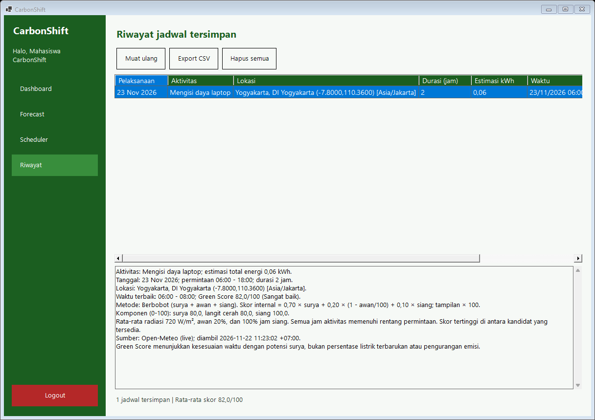

# Panduan Pengguna CarbonShift

**Junior Project - Climate Action | Versi 1.0.0 | Windows x64**

CarbonShift membantu memilih waktu aktivitas listrik berdasarkan prakiraan cuaca dan potensi surya. Pengguna dapat membuat akun, mencari rekomendasi, menyimpan jadwal, dan melihat riwayatnya sendiri.

## 1. Sebelum menjalankan aplikasi

- Gunakan Windows 64-bit. Paket ini tidak ditujukan untuk macOS, Linux, atau Windows 32-bit.
- Visual Studio, .NET SDK, dan .NET Runtime tidak perlu dipasang untuk memakai paket self-contained.
- PostgreSQL harus dipasang terpisah dan layanannya aktif. Paket tidak menyertakan server PostgreSQL.
- Internet diperlukan untuk mencari kota dan mengambil forecast terbaru. Cache hanya membantu jika data yang sesuai pernah diambil.

### Memasang PostgreSQL jika belum tersedia

1. Unduh installer Windows melalui [situs resmi PostgreSQL](https://www.postgresql.org/download/windows/). Pengujian lokal paket menggunakan PostgreSQL 18.
2. Pasang komponen PostgreSQL Server. pgAdmin boleh digunakan untuk pengelolaan manual.
3. Catat password untuk akun PostgreSQL `postgres`. Akun ini berbeda dari akun pengguna CarbonShift.
4. Port default adalah `5432`. Jika diganti atau port sudah dipakai, gunakan port instalasi tersebut pada wizard.
5. Selesaikan instalasi. Jika koneksi gagal, buka Windows Services dan pastikan layanan PostgreSQL berstatus Running.

### Membuka paket

1. Klik kanan ZIP submisi, lalu pilih **Extract All** ke folder yang dapat ditulis, misalnya Documents.
2. Buka folder hasil ekstraksi dan jalankan **CarbonShift.exe**.
3. Pertahankan seluruh DLL dan file runtime di samping executable. Jangan menjalankan aplikasi langsung dari tampilan isi ZIP atau memindahkan hanya file EXE.
4. Pada pemakaian pertama, ikuti Pengaturan database. Setelah konfigurasi berhasil, penggunaan berikutnya langsung menuju halaman Masuk.

Pengaturan dan cache disimpan dalam profil Windows di `%LocalAppData%\CarbonShift`, bukan di dalam ZIP. Laporan testing Modul 10 milik kelompok disertakan terpisah oleh pengumpul.

<!-- pagebreak -->

## 2. Pengaturan database pertama kali

Isi koneksi PostgreSQL, lalu pilih **Uji koneksi**. Tombol ini tidak mengubah database.

| Field | Contoh / keterangan |
| --- | --- |
| Host | `localhost` untuk PostgreSQL pada laptop yang sama |
| Port | `5432`, atau port yang dipilih saat instalasi |
| Nama database | `carbonshift`. Jangan memakai `postgres` atau database template |
| Username | `postgres`, atau akun PostgreSQL yang diberikan pengelola |
| Password | Password PostgreSQL dari proses instalasi |


Klik **Siapkan dan simpan** setelah isian benar. Database baru memerlukan hak CREATEDB. Database kosong akan diisi lima tabel dan akun contoh. Database CarbonShift yang sudah sesuai langsung dipakai. Data lama tidak dihapus. Schema parsial/berbeda ditolak untuk mencegah perubahan yang tidak diinginkan.

Jika konfigurasi perlu diganti, buka **Pengaturan database** di halaman Masuk. Batal saat pengaturan ulang mempertahankan koneksi sebelumnya. Batal pada setup pertama menutup aplikasi.

<!-- pagebreak -->

## 3. Membuat akun atau masuk

Pilih **Belum punya akun? Daftar**, isi nama dan email, lalu masukkan password 8-128 karakter dan konfirmasinya. Klik **Buat akun** untuk langsung masuk Dashboard tanpa verifikasi email.


Email tidak membedakan kapital. Password harus sama persis, termasuk spasi yang sengaja dimasukkan. Riwayat akun baru masih kosong.

Untuk masuk kembali, gunakan mode **Masuk**. Akun contoh pada database yang baru disiapkan adalah **admin@carbonshift.com** dengan password **12345**. Database lama belum tentu memiliki akun contoh. Pengguna tetap dapat mendaftar sendiri. Kredensial PostgreSQL tidak dipakai pada form Masuk ini.

Setelah Logout, aplikasi kembali ke mode Masuk dengan password kosong. Setiap akun memiliki riwayat terpisah.

<!-- pagebreak -->

## 4. Pilih lokasi dan ambil forecast

1. Di Dashboard, ketik nama kota Indonesia pada field **Lokasi prakiraan**.
2. Klik **Cari kota** atau tekan Enter. Pilih kota/provinsi yang sesuai pada dropdown di field yang sama.
3. Lokasi langsung diterapkan dan forecast diambil. Periksa sumber data dan waktu pengambilannya.
4. Buka **Forecast** untuk melihat data per jam dan memilih tanggal hari ini, besok, atau lusa.


**Open-Meteo (live)** berarti data baru dari API. **Cache** adalah data tersimpan. **Cache cadangan** dipakai ketika API gagal dan umur/cakupannya masih sesuai. **DEMO** adalah data buatan yang tidak bisa disimpan sebagai jadwal.

Pengaturan lokasi hanya tampil di Dashboard. Lokasi terakhir diingat per akun. Klik **Ambil ulang forecast** untuk memperbarui data atau keluar dari mode demo. Semua jam aktivitas mengikuti zona waktu kota yang berupa WIB, WITA, atau WIT.

<!-- pagebreak -->

## 5. Cari rekomendasi dan simpan jadwal

1. Buka **Scheduler**. Pilih preset atau ketik nama aktivitas sendiri.
2. Pilih tanggal, estimasi total energi aktivitas (kWh), dan durasi 1-12 jam.
3. Atur batas mulai dan selesai dalam satu hari. Jam selesai 24 berarti tengah malam berikutnya.
4. Pilih metode skor, lalu klik **Cari rekomendasi**. Metode default memakai bobot surya 70%, awan 20%, dan siang 10%.
5. Baca waktu terbaik, peringkat alternatif, dan penjelasan. Klik **Simpan ke riwayat** untuk menyimpan rekomendasi terbaik dari data nyata/cache.


Green Score 0-100 menunjukkan kesesuaian waktu dengan potensi surya, bukan persentase listrik terbarukan atau pengurangan emisi aktual. Skor minimal 70 masuk kategori Sangat baik. Skor 40 hingga kurang dari 70 masuk kategori Cukup, dan skor di bawah 40 masuk kategori Rendah.

Perubahan input atau forecast membatalkan hasil lama. Hitung ulang sebelum menyimpan. Waktu yang sudah lewat, forecast kedaluwarsa, dan data demo tidak dapat disimpan. Jika tidak ada kandidat, coba tanggal/rentang lain atau kurangi durasi.

<!-- pagebreak -->

## 6. Riwayat, export, dan dashboard

Buka **Riwayat** setelah menyimpan. Pilih baris untuk membaca penjelasan. Data tetap tersimpan setelah aplikasi ditutup dan dibuka kembali. Tombol **Export CSV** mengekspor baris yang ditampilkan. **Hapus semua** meminta konfirmasi dan hanya menghapus riwayat akun aktif.



Dashboard merangkum jumlah jadwal pada minggu berjalan (Senin-Minggu), rata-rata skor, dan jadwal mendatang. Angka tersebut menunjukkan jadwal yang disimpan, bukan bukti aktivitas sudah dilaksanakan atau energi benar-benar dikonsumsi.

Gunakan **Logout** di bawah sidebar untuk berganti akun. Untuk mengubah koneksi PostgreSQL, lakukan dari halaman Masuk setelah logout.

<!-- pagebreak -->

## 7. Jika ada kendala

| Gejala | Langkah yang dilakukan |
| --- | --- |
| Tidak terhubung ke PostgreSQL | Pastikan server terpasang, layanan Running, dan host/port sesuai. Gunakan Uji koneksi. |
| Password PostgreSQL ditolak | Isi password PostgreSQL dari instalasi, bukan password akun CarbonShift. |
| Hak akses kurang | Gunakan akun dengan CREATEDB untuk DB baru dan CREATE pada schema public untuk tabel baru. Hubungi pengelola jika perlu. |
| Schema tidak sesuai | Jangan menghapus DB lama. Gunakan nama database baru atau minta pengelola memeriksa schema. |
| Email sudah terdaftar | Pilih mode Masuk atau gunakan email lain. |
| Tidak ada slot cocok | Pilih besok/lusa, perluas rentang, atau kurangi durasi. Semua interval harus memiliki data lengkap. |
| Forecast gagal | Periksa internet dan ambil ulang. Cache cadangan hanya tersedia jika pernah mengambil data yang masih sesuai. |
| Simpan nonaktif | Cari ulang setelah mengubah input. Pastikan sumber bukan DEMO dan waktunya belum lewat. |
| Konfigurasi lokal tidak tersimpan | Pastikan profil Windows dapat ditulis dan ruang penyimpanan tersedia. |

### Konfigurasi lanjutan dan pembaruan paket

Aplikasi membaca konfigurasi dari environment variable `CARBONSHIFT_DB`, konfigurasi wizard dalam `%LocalAppData%\CarbonShift\database.config`, lalu file lama di samping EXE. Jika CARBONSHIFT_DB aktif, wizard menampilkan field terkunci. Ubah/hapus variabel melalui Windows Environment Variables dan mulai ulang aplikasi untuk kembali ke konfigurasi wizard.

File konfigurasi lokal memuat kredensial PostgreSQL. Jangan memasukkannya ke ZIP atau membagikannya. Saat menerima versi aplikasi baru, ekstrak ke folder baru. Konfigurasi profil Windows dan database tetap terpisah dari paket aplikasi.

### Setup SQL manual (opsional)

Wizard tidak memerlukan psql atau pgAdmin. Jika pengelola memilih setup manual untuk database baru, jalankan perintah berikut dari folder Database.

```text
psql -U postgres -h localhost -d postgres -f schema.psql
psql -U postgres -h localhost -d carbonshift -f seed.sql
```

Script schema manual membuat database baru bernama carbonshift dan akan gagal jika database itu sudah ada. Script ini tidak melakukan reset. Untuk database lama yang sesuai, cukup pakai wizard. Nama/tipe tabel tetap mengikuti rancangan resmi kelompok.
